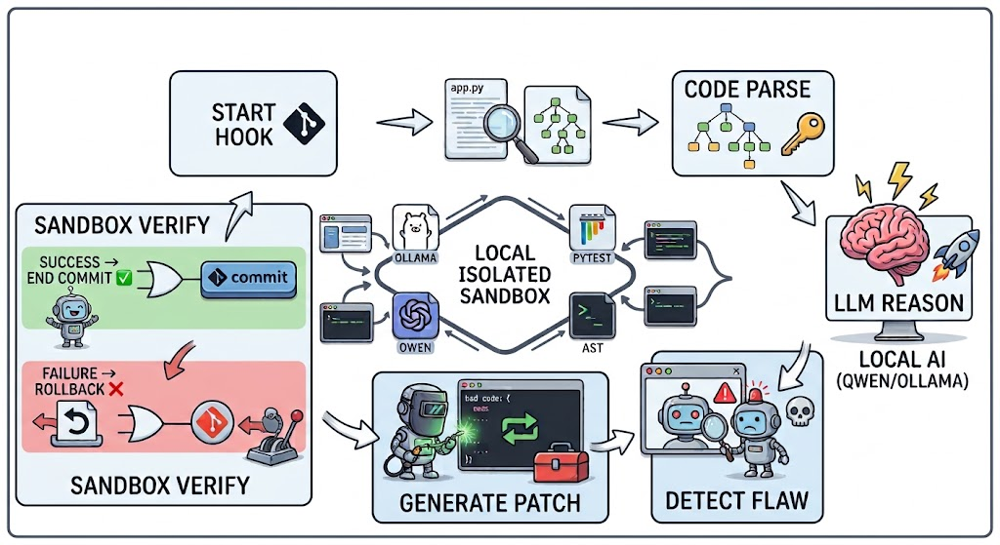

# Local-First Autonomous Security Agent

This repository contains an autonomous security assistant designed to automatically detect and fix vulnerabilities in Python code using local Large Language Models (LLMs).



The agent integrates several components:
1.  **AST Parsing**: Automatically identifies functions within staged files using the `ast` module.
2.  **LLM-Powered Auditing**: Uses a locally hosted LLM (via Ollama) to analyze code for common vulnerabilities like injection, insecure deserialization, and hardcoded secrets.
3.  **Automated Patching**: If a vulnerability is detected, the agent automatically refactors the code using the suggested fix from the model.
4.  **Verification Sandbox**: After applying a patch, the system runs `pytest` to ensure that the refactored code still satisfies all existing unit tests before finalizing changes.

## Project Structure
- `agent.py`: The core logic of the autonomous workflow.
- `ast_parser.py`: Handles Git integration and AST extraction of Python functions.
- `llm_client.py`: Manages communication with the Ollama API to get structured JSON analysis.
- `patcher.py`: Handles the application of refactored code snippets back into source files.
- `sandbox.py`: A test verification layer that runs `pytest` after every patch.
- `test_app.py`: Sample application containing vulnerabilities for testing purposes.

## Key Features
- 🤖 **Fully Autonomous**: Automatically detects, fixes, and verifies security issues in your staging area.
- 🛡️ **Local First**: Uses Ollama to ensure code remains private; no data is sent to external cloud providers.
- ✅ **Validation Loop**: Only accepts patches that pass the existing test suite.
- 🐍 **Language Specific**: Tailored for Python, leveraging AST for accurate context extraction.

## Getting Started

### Prerequisites
*   Python 3.10+
*   [Ollama](https://ollama.com/) installed on your local machine.
*   A supported model (e.g., `qwen2.5-coder:7b-instruct`).

### Installation
1.  Clone the repository:
    ```bash
    git clone <repository_url>
    cd <repo_name>
    ```
2.  Create a virtual environment and install dependencies:
    ```bash
    python -m venv venv
    source venv/bin/activate  # On Windows use .\venv\Scripts\activate
    pip install -r requirements.txt
    ```
3.  Pull the required model via Ollama:
    ```bash
    ollama pull qwen2.5-coder:7b-instruct-q4_K_M
    ```

### Usage
The agent operates on files that are currently staged in Git.

1.  Prepare a bug (e.g., use `test_app.py`).
2.  Stage the changes:
    ```bash
    git add .
    ```
3.  Run the security auditor:
    ```bash
    python agent.py
    ```

## Technical Architecture
1. **Scan**: `LocalASTAnalyzer` identifies staged files and pulls specific functions into a queue.
2. **Evaluate**: Each function is passed to `llm_client.py`. The LLM returns a JSON object containing a boolean "vulnerable" flag, severity level, issue descriptions, and refactored code.
3. **Fix**: If flagged as vulnerable, `CodePatcher` replaces the source lines with the model's suggested fix.
4. **Verify**: `TestSandbox` executes `pytest`. If tests fail, it prompts a rollback of the specific file.

## License
MIT
